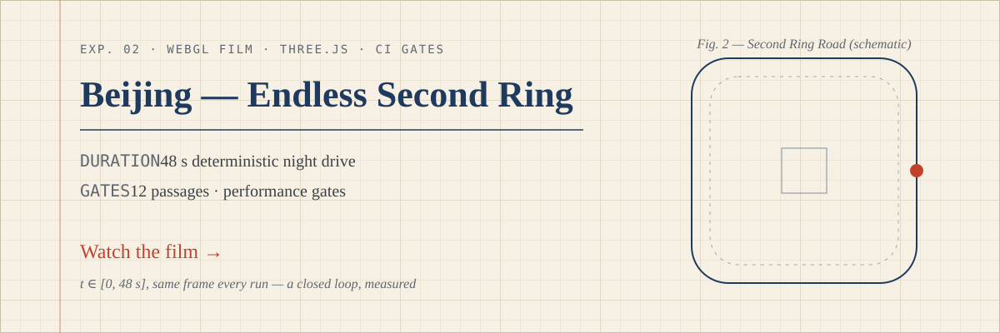

# Yupeng Lu

**AI agent & backend engineer — I take agents from demo to production: MCP tools, guardrails, evals, billing, real-time systems.**

1. [Site](https://brickerp.github.io/)
2. [Live dashboard](https://quant.oakrelay.dpdns.org/) · [classic CloudFront](https://d2c9pzwpavuktk.cloudfront.net/). Strategy and P&L stay private.
3. [Architecture](https://github.com/BrickerP/quant-trading/blob/develop/docs/architecture/README.md)
4. [Contact / Hire](https://brickerp.github.io/#contact)

Part-time / contract · ~20 h/week · Diamond Bar, California (PT) · US permanent resident · [yplmicro@gmail.com](mailto:yplmicro@gmail.com)
